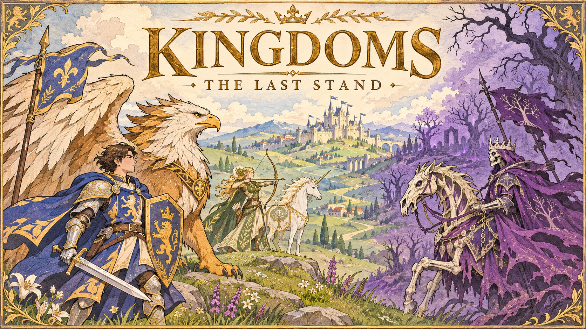

# Kingdoms · The Last Stand

Storybook turn-based battles inspired by Heroes III. Five factions, 35 creatures, four battlefields.

**[Play in your browser](https://eric-schecter.github.io/kingdoms/)**

Choose a faction and battlefield. Click to move or attack; right-click a creature for details. Scroll the initiative bar to see upcoming turns.

Open `project.godot` with **Godot 4.7.2** to play locally. Run `tools/export_web.sh` to build the web edition.

Original AI-generated artwork. [Audio credits and licenses](assets/audio/sources/CREDITS.md). An unofficial fan-inspired prototype.
